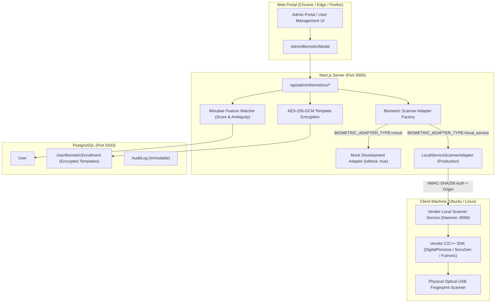

# Enterprise Fingerprint Scanner Integration Guide
**Ruqayya Clinic & Pharmacy Hospital Management System**

This document details the architecture, local scanner service daemon, and vendor SDK requirements for connecting physical optical USB fingerprint scanners to the Ruqayya Clinic web portal on Ubuntu / Linux.

---

## 1. Web Portals vs. Hardware Fingerprint Scanners

### The Fundamental Architectural Boundary
A web browser running in a sandbox **never has direct, unmediated access to physical USB hardware or raw biometric images**.
- **WebAuthn / Passkeys:** Authenticates specific pre-registered credentials on a 1:1 basis. WebAuthn intentionally does not expose minutiae templates or permit 1:N database searches across a roster of users or patients.
- **Biometric 1:N Identification:** Requires capturing a raw optical/capacitive fingerprint, extracting minutiae (ridge endings, bifurcations, core, delta) per ISO/IEC 19794-2 or ANSI-378 standards, and searching against hundreds or thousands of encrypted enrolled templates in the database.

---

## 2. System Architecture



---

## 3. Replaceable Adapter Layer

All biometric operations are isolated behind the `IBiometricScannerAdapter` interface ([`src/lib/biometrics/types.ts`](file:///home/taimoor-malik/Documents/HMS/src/lib/biometrics/types.ts)):

| Adapter | Environment | `isMock` | Status / Capabilities |
| :--- | :---: | :---: | :--- |
| **`MockDevelopmentScannerAdapter`** | Local Development & CI | `true` | Synthesizes ISO 19794-2 minutiae vectors, executes real spatial distance/angle matching, handles ambiguity & disconnect states. Labeled as dev mock. |
| **`LocalServiceScannerAdapter`** | Hardware Production | `false` | Connects to a local daemon on `http://127.0.0.1:9099` using HMAC-SHA256 signatures, short-lived timestamps, and origin enforcement. |

---

## 4. Hardware Verification & Linux Support Matrix

Before physical hardware deployment, ensure your scanner vendor provides official 64-bit Linux (`x86_64`) shared libraries (`.so`) and udev rules:

| Scanner Manufacturer | Recommended Model | Linux SDK | 1:N Engine Support |
| :--- | :--- | :--- | :--- |
| **HID Global / DigitalPersona** | U.are.U 4500 / 5160 / 5300 | DigitalPersona One Touch for Linux SDK (`libdpfpdd.so`) | Supported via One Touch ID engine |
| **SecuGen** | Hamster Pro 20 / Hamster Plus | SecuGen FDx SDK Pro for Linux (`libsgfplib.so`) | Supported (ISO/ANSI template extractor) |
| **Futronic** | FS80H / FS88H | FinLogon SDK / Linux ScanAPI (`libftrScanAPI.so`) | Supported |
| **ZKTeco** | ZK4500 / ZK9500 | ZKFinger SDK for Linux (`libzkfp.so`) | Supported (ZKFinger 10.0 algorithm) |

> [!CAUTION]
> **Laptop Built-in Readers (e.g. Elan, Goodix, Synaptics match-on-chip):**
> These sensors are wired to the OS login stack (`pam_fprintd`). They do not export unencrypted minutiae templates or support 1:N database searching for third-party applications. Physical optical USB scanners are required for hospital 1:N patient/staff identification.

---

## 5. Local Daemon Security Requirements

When deploying the vendor local scanner daemon:
1. **Origin Restriction:** The daemon must verify the `Origin: http://localhost:3000` (or clinic domain) header on every HTTP/WebSocket request.
2. **Authenticated Pairing:** The daemon and the clinic backend share `BIOMETRIC_AGENT_TOKEN`.
3. **Replay Protection:** Requests must include `X-Biometric-Timestamp` (rejected if older than 15 seconds) and a unique `X-Biometric-Nonce`.
4. **No Plaintext Logging:** The daemon must never output raw fingerprint image bitmaps (`.raw`, `.bmp`, `.wsq`) to disk or log minutiae in plain text.

---

## 6. Environment Variables

Configure in `.env`:

```env
# Options: "mock" (default for development) | "local_service" (production hardware)
BIOMETRIC_ADAPTER_TYPE="mock"

# 32-byte hex-encoded encryption key for AES-256-GCM biometric template protection
BIOMETRIC_ENCRYPTION_KEY="0123456789abcdef0123456789abcdef0123456789abcdef0123456789abcdef"

# Local Vendor Scanner Daemon Settings (When BIOMETRIC_ADAPTER_TYPE="local_service")
BIOMETRIC_AGENT_URL="http://127.0.0.1:9099"
BIOMETRIC_AGENT_TOKEN="your-secure-shared-pairing-token"
```
